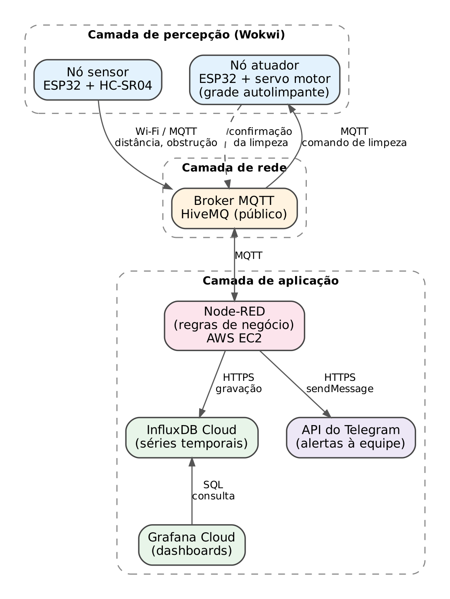
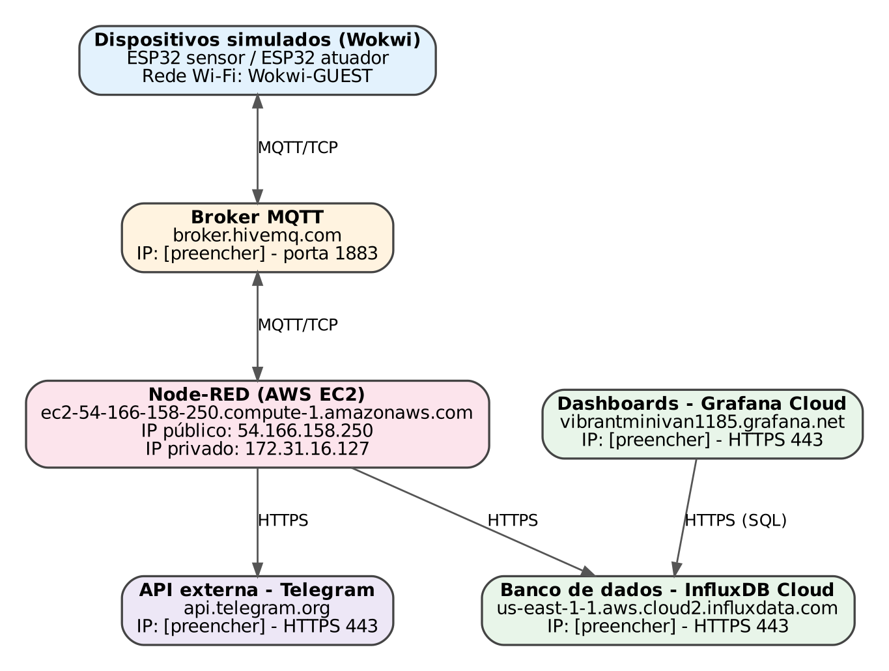
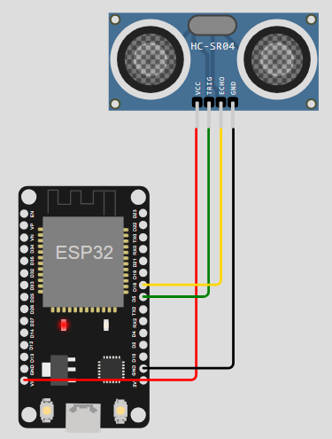
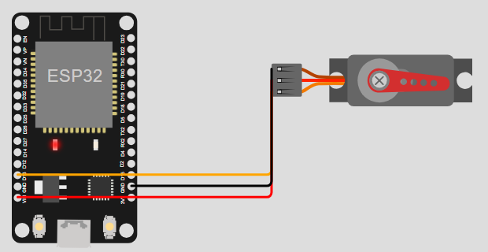
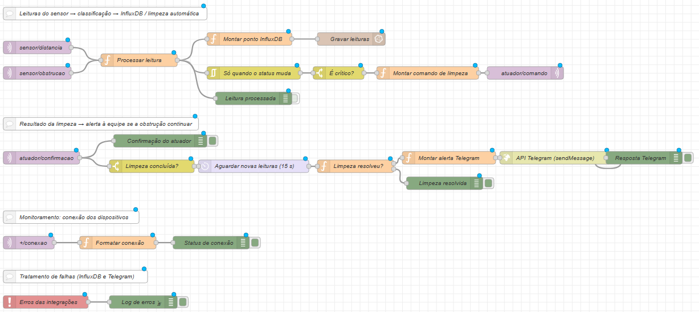
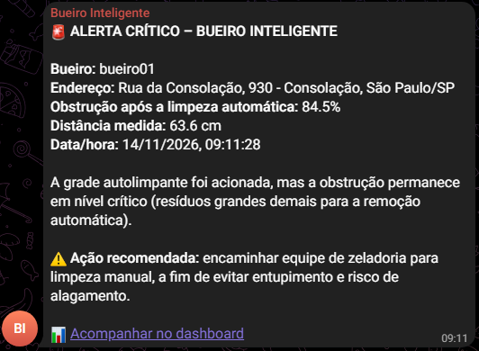
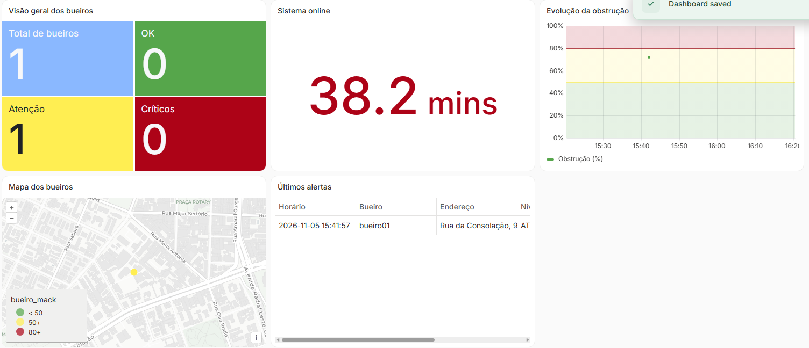

# Bueiro Inteligente: Uma Solução Automatizada para a Prevenção de Alagamentos

Projeto da disciplina **Objetos Inteligentes Conectados** — Universidade Presbiteriana Mackenzie, Faculdade de Computação e Informática.

**Integrantes:** Ana Beatriz Oliveira, Gustavo Pan, Isaac Carone e Wallace Santana

**Vídeo de demonstração:** _link do YouTube (a ser incluído)_

---

## Sumário

1. [Descrição do projeto](#1-descrição-do-projeto)
2. [Arquitetura](#2-arquitetura)
3. [Hardware e ligações](#3-hardware-e-ligações)
4. [Comunicação MQTT](#4-comunicação-mqtt)
5. [Regras de negócio (Node-RED)](#5-regras-de-negócio-node-red)
6. [Banco de dados e dashboards](#6-banco-de-dados-e-dashboards)
7. [Como reproduzir o projeto](#7-como-reproduzir-o-projeto)
8. [Estrutura do repositório](#8-estrutura-do-repositório)

---

## 1. Descrição do projeto

O entupimento de bueiros (bocas de lobo) por resíduos sólidos é uma das principais causas de alagamentos nas cidades brasileiras. Hoje, a limpeza costuma ser feita por calendário fixo ou depois que o alagamento já aconteceu.

O **Bueiro Inteligente** é um protótipo de Internet das Coisas (IoT) que mede continuamente o nível de obstrução de um bueiro e:

- aciona automaticamente uma **grade autolimpante** (servo motor) quando o bueiro atinge o nível crítico;
- grava o histórico em um **banco de dados de séries temporais em nuvem** (InfluxDB Cloud);
- apresenta as informações em **dashboards gerenciais** (Grafana Cloud);
- envia um **alerta automático pelo Telegram** à equipe de manutenção **somente quando a limpeza automática não resolve** a obstrução.

O projeto está alinhado ao **ODS 11 (Cidades e Comunidades Sustentáveis)**, **meta 11.6** da Agenda 2030 da ONU: reduzir o impacto ambiental negativo das cidades, incluindo a gestão de resíduos. A solução troca a manutenção reativa por uma manutenção **preventiva e orientada por dados**.

### Classificação do nível de obstrução

| Obstrução | Estado | Classificação | Ação |
|---|---|---|---|
| Abaixo de 50% | Normal | 🟢 Verde | — |
| De 50% a 74% | Atenção | 🟡 Amarelo | Acompanhar no dashboard |
| 75% ou mais | Crítico | 🔴 Vermelho | Limpeza automática da grade; alerta no Telegram se a obstrução continuar |

---

## 2. Arquitetura

<p align="center"></p>

| Camada | Componente | Tecnologia |
|---|---|---|
| Percepção | Nó sensor | ESP32 + HC-SR04 (simulado no Wokwi) |
| Percepção | Nó atuador | ESP32 + servo motor da grade autolimpante (simulado no Wokwi) |
| Rede | Broker MQTT | HiveMQ público (`broker.hivemq.com:1883`) |
| Aplicação | Regras de negócio | Node-RED em máquina virtual AWS EC2 |
| Aplicação | Banco de dados | InfluxDB Cloud Serverless |
| Aplicação | Dashboards | Grafana Cloud |
| Aplicação | API externa | Telegram Bot API |

### Topologia lógica

<p align="center"></p>

O broker MQTT, o Node-RED, o banco de dados e o gerador de dashboards estão hospedados em máquinas distintas.

---

## 3. Hardware e ligações

Os dois dispositivos são simulados na plataforma [Wokwi](https://wokwi.com) com a placa **ESP32 DevKit V1** e se conectam à Internet pela rede Wi-Fi simulada `Wokwi-GUEST`.

### Nó sensor (ESP32 + HC-SR04)

| HC-SR04 | ESP32 |
|---|---|
| VCC | VIN (5 V) |
| GND | GND |
| TRIG | GPIO 5 |
| ECHO | GPIO 18 |

<p align="center"></p>

O percentual de obstrução é calculado a partir da distância medida (`d`, em cm), considerando **400 cm** como bueiro vazio e **2 cm** como bueiro totalmente obstruído:

```
obstrução (%) = (400 − d) / (400 − 2) × 100     (limitado entre 0% e 100%)
```

As leituras são publicadas a cada 5 segundos.

### Nó atuador (ESP32 + servo motor da grade autolimpante)

| Servo motor | ESP32 |
|---|---|
| PWM (sinal) | GPIO 13 |
| V+ | VIN (5 V) |
| GND | GND |

Ao receber o comando `limpar`, o servo movimenta a grade em **duas passadas de 0° a 180°** para soltar os resíduos e informa o início (`limpando`) e o fim (`limpeza_concluida`) da limpeza. O controle usa a biblioteca **ESP32Servo**.

<p align="center"></p>

### Adaptações

- **Comunicação:** em uma implantação real, bueiros ficam no subsolo e espalhados pela cidade, então o meio mais adequado seria o **LoRaWAN** (longo alcance e baixo consumo). No protótipo foi usado Wi-Fi, porque o Wokwi não simula LoRaWAN. A aplicação não muda: o servidor de rede LoRaWAN poderia publicar as leituras no mesmo broker MQTT.
- **Sensor:** em campo, o ambiente úmido exigiria um sensor ultrassônico à prova d'água, como o **JSN-SR04T**, que funciona da mesma forma que o HC-SR04.
- **Atuador:** o servo representa, em escala, o mecanismo da grade. Em uma implantação real seria usado um **motorredutor à prova d'água**, com mais torque, acionado pelo mesmo comando MQTT.

---

## 4. Comunicação MQTT

Broker: `broker.hivemq.com`, porta `1883`. Padrão dos tópicos:

```
mackenzie/bueiro-inteligente/{id_bueiro}/{dispositivo}/{informação}
```

| Tópico (após `mackenzie/bueiro-inteligente/bueiro01/`) | Direção | Conteúdo | QoS / Retain |
|---|---|---|---|
| `sensor/distancia` | Sensor → Node-RED | Distância em cm (ex.: `77.6`) | 0 |
| `sensor/obstrucao` | Sensor → Node-RED | Obstrução em % (ex.: `81.0`) | 0 |
| `sensor/conexao` | Sensor → Node-RED | `online` / `offline` (LWT) | 1 / retain |
| `atuador/comando` | Node-RED → Atuador | `limpar` (ou `repouso`) | 1 / sem retain |
| `atuador/confirmacao` | Atuador → Node-RED | `limpando` / `limpeza_concluida` | 0 |
| `atuador/conexao` | Atuador → Node-RED | `online` / `offline` (LWT) | 1 / retain |

Cada dispositivo registra uma mensagem de última vontade (LWT) com o valor `offline`. Se a conexão cair, o próprio broker publica essa mensagem.

> A biblioteca PubSubClient publica apenas com QoS 0. O QoS 1 é aplicado à LWT e aos comandos publicados pelo Node-RED. O comando de limpeza **não** é retido, para que a grade não repita a limpeza sempre que o atuador reconectar.

---

## 5. Regras de negócio (Node-RED)

<p align="center"></p>

A cada leitura de obstrução, o fluxo:

1. **Classifica** o nível (verde, amarelo ou vermelho);
2. **Grava** a leitura no InfluxDB, com identificação, estado e localização do bueiro;
3. **Aciona a limpeza automática** quando o estado muda para crítico, publicando `limpar` em `atuador/comando`. Um filtro *report by exception* garante **uma limpeza por ocorrência**, e não uma a cada 5 segundos;
4. **Verifica o resultado:** ao receber `limpeza_concluida`, aguarda 15 segundos e confere a última leitura do sensor;
5. **Envia alerta pelo Telegram** somente se a obstrução continuar em 75% ou mais (resíduos grandes demais para a remoção automática), recomendando a limpeza manual. Se a limpeza resolveu, o fluxo apenas registra o resultado.

Um nó `catch` registra erros do InfluxDB e do Telegram sem interromper o comando de limpeza.

<p align="center"></p>

---

## 6. Banco de dados e dashboards

**InfluxDB Cloud:** bucket `bueiro_inteligente`, measurement `leituras`.

| Tipo | Nome | Descrição |
|---|---|---|
| Tag | `id_bueiro` | Identificador do bueiro |
| Field | `distancia_cm` | Distância medida (cm) |
| Field | `obstrucao_pct` | Nível de obstrução (%) |
| Field | `status` | `verde`, `amarelo` ou `vermelho` |
| Field | `latitude`, `longitude`, `endereco` | Localização do bueiro |

**Grafana Cloud:** dashboard com 5 painéis, construído a partir do esboço da primeira entrega.

<p align="center"></p>

| Painel | Pergunta que responde |
|---|---|
| Visão geral dos bueiros | Quantos bueiros estão OK, em atenção ou críticos? |
| Sistema online | O sensor está enviando dados? |
| Mapa dos bueiros | Onde ficam os bueiros que precisam de atenção? |
| Últimos alertas | Quando cada bueiro mudou de estado? |
| Evolução da obstrução | Qual a velocidade de acúmulo de resíduos? |

As consultas SQL de cada painel estão em [`grafana/consultas.sql`](grafana/consultas.sql).

---

## 7. Como reproduzir o projeto

### 7.1 Dispositivos (Wokwi)

1. Crie **dois** projetos ESP32 em [wokwi.com](https://wokwi.com).
2. No primeiro (nó sensor), substitua `sketch.ino`, `diagram.json` e `libraries.txt` pelos arquivos de [`dispositivos/no-sensor`](dispositivos/no-sensor).
3. No segundo (nó atuador), faça o mesmo com os arquivos de [`dispositivos/no-atuador`](dispositivos/no-atuador). O `libraries.txt` já inclui a biblioteca **ESP32Servo**.
4. Rode as duas simulações ao mesmo tempo, **em janelas separadas e visíveis**. O navegador pausa simulações em abas que ficam em segundo plano.
5. No sensor, clique no HC-SR04 durante a simulação e arraste a distância para simular o acúmulo de resíduos.

### 7.2 InfluxDB Cloud

1. Crie uma conta em [cloud2.influxdata.com](https://cloud2.influxdata.com) (plano gratuito).
2. Crie o bucket **`bueiro_inteligente`**.
3. Gere dois tokens em **Load Data → API Tokens**:
   - um com permissão de **escrita** no bucket, para o Node-RED;
   - um com permissão **somente de leitura**, para o Grafana.
4. Anote a **URL** da instância e o **nome da organização**.

### 7.3 Bot do Telegram

1. No Telegram, fale com o **@BotFather**, envie `/newbot` e guarde o **token** do bot.
2. Crie um grupo, adicione o bot e envie `/start@nome_do_bot` no grupo.
3. Acesse `https://api.telegram.org/bot<TOKEN>/getUpdates` e copie o `chat.id` do grupo (número negativo).

### 7.4 Node-RED

1. Instale o Node-RED (ex.: em uma VM AWS EC2) e, em **Gerenciar paleta**, instale `node-red-contrib-influxdb`.
2. Importe o arquivo [`node-red/flows.json`](node-red/flows.json) (**☰ → Importar**).
3. No nó **Gravar leituras**:
   - edite o servidor **InfluxDB Cloud** e informe a URL e o token de escrita;
   - em **Organization**, troque `SUA_ORGANIZACAO` pelo nome da sua organização.
4. Dê dois cliques na aba **Bueiro Inteligente** e preencha as variáveis de ambiente:
   - `TELEGRAM_BOT_TOKEN`: token do bot;
   - `TELEGRAM_CHAT_ID`: id do grupo;
   - `LINK_DASHBOARD`: endereço do seu dashboard no Grafana (opcional).
5. Clique em **Implementar**.

### 7.5 Grafana Cloud

1. Crie uma stack gratuita em [grafana.com](https://grafana.com).
2. Em **Connections → Data sources**, adicione um **InfluxDB** com:
   - **Query language:** SQL
   - **URL:** a URL da sua instância do InfluxDB
   - **Database:** `bueiro_inteligente`
   - **Token:** o token somente de leitura
3. Crie um dashboard e adicione os 5 painéis usando as consultas e as configurações de [`grafana/consultas.sql`](grafana/consultas.sql).

> **Segurança:** nenhum token ou chave de API está neste repositório. Os valores devem ser configurados nas credenciais e nas variáveis de ambiente do Node-RED e do Grafana.

---

## 8. Estrutura do repositório

```
├── README.md
├── dispositivos/
│   ├── no-sensor/         # ESP32 + HC-SR04
│   │   ├── sketch.ino
│   │   ├── diagram.json
│   │   └── libraries.txt
│   └── no-atuador/        # ESP32 + servo motor (grade autolimpante)
│       ├── sketch.ino
│       ├── diagram.json
│       └── libraries.txt
├── node-red/
│   └── flows.json         # Fluxo completo (sem tokens)
├── grafana/
│   └── consultas.sql      # Consultas SQL dos painéis
└── docs/
    └── imagens/           # Diagramas e capturas de tela
```
